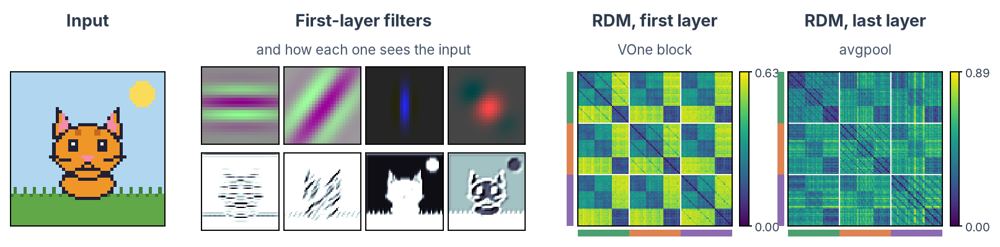

# Formatting gallery

Every building block the wiki uses, each shown twice: **Preview** is what readers see, **Markdown** is what you write. Click a tab once and every entry on the page switches with it. (On GitHub you only see the raw text.)

| Group | Entries |
|---|---|
| Lists | [Bullets and numbered lists](#bullets-and-numbered-lists), [steps in order](#steps-in-order), [collapsible lists](#collapsible-lists), [checklists](#checklists), [terms and definitions](#terms-and-definitions) |
| Boxes | [Callouts](#callouts), [collapsible callouts](#collapsible-callouts), [do and don't](#do-and-dont), [emergency card](#emergency-card) |
| Layout | [Tabs](#tabs), [cards](#cards), [model and tool cards](#model-and-tool-cards), [two columns](#two-columns), [buttons](#buttons), [tables](#tables), [yes/no tables](#yesno-tables), [visual angle calculator](#visual-angle-calculator) |
| Images | [Images](#images), [figure with a caption](#figure-with-a-caption) |
| Text | [Inline formatting](#inline-formatting), [progress bar](#progress-bar) |
| Code | [Code blocks](#code-blocks), [long lines in text blocks](#long-lines-in-text-blocks), [code with numbered notes](#code-with-numbered-notes) |
| Shared and hidden text | [The same text on several pages](#the-same-text-on-several-pages), [open tasks on a page](#open-tasks-on-a-page), [your name under each page](#your-name-under-each-page) |

!!! tip "Which one do I use?"
    | Your content | Use |
    |---|---|
    | A list of items, each with a paragraph or more of explanation, all relevant to every reader | `??? numlist` / `??? deflist` |
    | Steps done in order, each with an explanation | `???+ steps` |
    | Steps done in order, written as plain sentences or always visible (emergencies) | `<div class="steps-list" markdown>` around a numbered list |
    | Items with a one-line explanation, points with no order, or steps short enough to need no line | a plain bullet or numbered list (styled automatically) |
    | The reader needs exactly **one** of several alternatives (Windows/macOS, one of three procedures) | [content tabs](https://squidfunk.github.io/mkdocs-material/reference/content-tabs/) (`=== "Tab"`) |
    | A single aside, warning or tip interrupting the text | `!!! warning`, `!!! tip`, … |
    | Troubleshooting entries the reader consults only when something breaks | `??? failure "Symptom"` |
    | The main places a reader can go from an index page | grid cards (`<div class="grid cards" markdown>`) |
    | One action: download a file, open an external site | a button (`{ .md-button }`) |
    | Code lines that need a short explanation | code notes (`# (1)!` and a numbered list under the code) |
    | An icon or small screenshot that should not open large | `{ .off-glb }` after the image |
    | Stimulus sizes in degrees, millimetres and pixels for a lab screen | the [visual angle calculator](#visual-angle-calculator) |

    A run of three or more `!!!` boxes in a row is a sign that none of them is
    really an aside, and that the section wants one of the list forms above.

## Lists

### Bullets and numbered lists

Plain Markdown lists get the wiki style on their own. Each level down is a little lighter (darker in dark mode).

=== "Preview"

    - A point
        - A detail
            - A finer detail

    1. First
    2. Second
        1. A sub-step
            1. A sub-sub-step

=== "Markdown"

    ```markdown
    - A point
        - A detail
            - A finer detail

    1. First
    2. Second
        1. A sub-step
            1. A sub-sub-step
    ```

### Steps in order

The numbers get a connecting line. Use it for a procedure whose steps are plain sentences, or one that must stay visible without clicking (an emergency).

=== "Preview"

    <div class="steps-list" markdown>

    1. Book the room.
    2. Prepare the participant.

    </div>

=== "Markdown"

    ```markdown
    <div class="steps-list" markdown>

    1. Book the room.
    2. Prepare the participant.

    </div>
    ```

### Collapsible lists

When a section is a **list of things that each need a short explanation**, such as the
documents an application must contain, the tools on a machine or the fields in a
form, use `??? numlist` (numbered) or `??? deflist` (bulleted) instead of a run
of `!!!` boxes. The term stays visible so the whole list can be scanned at a
glance, and the explanation opens on click. For **steps that follow each other in order** (a procedure, the path to a first session), use `??? steps`: a vertical line joins the numbers so the steps read as one sequence.

- `???` starts closed, `???+` starts open.
- Indent the body by **four spaces**, exactly like an admonition.
- Numbering is automatic and **restarts at every heading**, so you can reorder or
  insert entries without renumbering anything by hand.
- The line runs only between consecutive `steps` entries, so a paragraph or heading between two entries ends the
  sequence.
- Each entry gets its own anchor from its term, so you can link straight to it:
  `[the ICF requirements](MEC.md#informed-consent-forms-icfs)`. Opening such a
  link expands that entry. If the term is the same as a heading or another entry
  on the page, `-2`, `-3`, … is appended to keep the anchor unique. Everything also
  expands automatically when the page is printed or saved as PDF.

=== "Preview"

    ??? deflist "Laptop (bullet, closed)"
        Bring your own, with MATLAB installed.

    ???+ deflist "Charger (bullet, open)"
        The lab has no spare one.

    ??? numlist "Ethics application (numbered, closed)"
        Submit it before recruiting.

    ???+ numlist "Data management plan (numbered, open)"
        Write it with the RDM team.

    ???+ steps "Book the room (step, open)"
        Use the online calendar.

    ??? steps "Run the session (step, closed)"
        Follow the checklist.

=== "Markdown"

    ```markdown
    ??? deflist "Laptop (bullet, closed)"
        Bring your own, with MATLAB installed.

    ???+ deflist "Charger (bullet, open)"
        The lab has no spare one.

    ??? numlist "Ethics application (numbered, closed)"
        Submit it before recruiting.

    ???+ numlist "Data management plan (numbered, open)"
        Write it with the RDM team.

    ???+ steps "Book the room (step, open)"
        Use the online calendar.

    ??? steps "Run the session (step, closed)"
        Follow the checklist.
    ```

### Checklists

=== "Preview"

    - [x] Consent form signed
    - [ ] Data uploaded

=== "Markdown"

    ```markdown
    - [x] Consent form signed
    - [ ] Data uploaded
    ```

### Terms and definitions

=== "Preview"

    Sampling rate
    :   How many samples per second the amplifier records.

=== "Markdown"

    ```markdown
    Sampling rate
    :   How many samples per second the amplifier records.
    ```

## Boxes

### Callouts

Types: `note`, `abstract`, `info`, `tip`, `success`, `question`, `warning`, `failure`, `danger`, `bug`, `example`, `quote`.

=== "Preview"

    !!! tip "Good to know"
        Shown in a box.

    !!! warning
        Without a title, the box shows its type.

=== "Markdown"

    ```markdown
    !!! tip "Good to know"
        Shown in a box.

    !!! warning
        Without a title, the box shows its type.
    ```

### Collapsible callouts

`???` starts closed, `???+` starts open. Any type works.

=== "Preview"

    ??? info "More details (closed)"
        Hidden until clicked.

    ???+ example "An example (open)"
        Shown, and can be closed.

=== "Markdown"

    ```markdown
    ??? info "More details (closed)"
        Hidden until clicked.

    ???+ example "An example (open)"
        Shown, and can be closed.
    ```

### Do and don't

For safety and emergency information, two blocks follow the NHS design system
([care cards](https://service-manual.nhs.uk/design-system/components/care-cards),
[do and don't lists](https://service-manual.nhs.uk/design-system/components/do-and-dont-lists)).
Use them sparingly: one emergency card per page, for the number to call. For other warnings, use the usual `!!! danger` or `!!! warning` boxes.
`do-list` gives green ticks, `dont-list` red crosses.

=== "Preview"

    <div class="do-list" markdown>
    <p class="do-list__heading">Do</p>

    - Check the screening form.

    </div>

    <div class="dont-list" markdown>
    <p class="do-list__heading">Don't</p>

    - Start without a signed form.

    </div>

=== "Markdown"

    ```markdown
    <div class="do-list" markdown>
    <p class="do-list__heading">Do</p>

    - Check the screening form.

    </div>

    <div class="dont-list" markdown>
    <p class="do-list__heading">Don't</p>

    - Start without a signed form.

    </div>
    ```

### Emergency card

One per page, for the number to call.

=== "Preview"

    <div class="care-card care-card--emergency" markdown>
    <p class="care-card__heading">Emergency: call 112</p>
    <div class="care-card__body" markdown>

    Say what happened and where you are.

    </div>
    </div>

=== "Markdown"

    ```markdown
    <div class="care-card care-card--emergency" markdown>
    <p class="care-card__heading">Emergency: call 112</p>
    <div class="care-card__body" markdown>

    Say what happened and where you are.

    </div>
    </div>
    ```

## Layout

### Tabs

Tabs with the same names switch together across the page.

=== "Preview"

    === "Windows"

        Steps for Windows.

    === "macOS"

        Steps for macOS.

=== "Markdown"

    ```markdown
    === "Windows"

        Steps for Windows.

    === "macOS"

        Steps for macOS.
    ```

### Cards

As many per row as fit, each about square.

=== "Preview"

    <div class="grid cards" markdown>

    - :material-school:{ .lg .middle } __Learn the basics__

        ---

        One sentence on what the reader finds there.

        [Start here](#cards)

    - :material-clipboard-text:{ .lg .middle } __Plan a study__

        ---

        One sentence on what the reader finds there.

        [Start here](#cards)

    </div>

=== "Markdown"

    ```markdown
    <div class="grid cards" markdown>

    - :material-school:{ .lg .middle } __Learn the basics__

        ---

        One sentence on what the reader finds there.

        [Start here](#cards)

    - :material-clipboard-text:{ .lg .middle } __Plan a study__

        ---

        One sentence on what the reader finds there.

        [Start here](#cards)

    </div>
    ```

### Model and tool cards

A card per model, tool or dataset, in groups with a colour: `classic`, `brain`, `language` or `topo`. The part above the line shows when the card is closed; add `open` to `<details` to show it open.

=== "Preview"

    #### Brain-inspired models { .resource-group .resource-group--brain }

    <details class="resource-card resource-card--brain" markdown>
    <summary markdown="block">

    #### VOneNet

    [:material-file-document-outline: Paper](https://proceedings.neurips.cc/paper/2020/hash/98b17f068d5d9b7668e19fb8ae470841-Abstract.html) [:material-github: Code](https://github.com/dicarlolab/vonenet)
    { .resource-card__links }

    **Pick it when** you want a model of primate V1 in front of a standard CNN.

    </summary>

    Architecture
    :   Fixed V1 model + ResNet-50

    Trained on
    :   ImageNet

    { .resource-card__figure }
    { .resource-card__plate }

    What the panels show, in one or two sentences.
    { .resource-card__caption }

    </details>

=== "Markdown"

    ```markdown
    #### Brain-inspired models { .resource-group .resource-group--brain }

    <details class="resource-card resource-card--brain" markdown>
    <summary markdown="block">

    #### VOneNet

    [:material-file-document-outline: Paper](https://proceedings.neurips.cc/paper/2020/hash/98b17f068d5d9b7668e19fb8ae470841-Abstract.html) [:material-github: Code](https://github.com/dicarlolab/vonenet)
    { .resource-card__links }

    **Pick it when** you want a model of primate V1 in front of a standard CNN.

    </summary>

    Architecture
    :   Fixed V1 model + ResNet-50

    Trained on
    :   ImageNet

    { .resource-card__figure }
    { .resource-card__plate }

    What the panels show, in one or two sentences.
    { .resource-card__caption }

    </details>
    ```

### Two columns

Side by side on wide screens, one under the other on phones.

=== "Preview"

    <div class="grid-2" markdown>

    **Left**: text, a list or an image.

    **Right**: the same.

    </div>

=== "Markdown"

    ```markdown
    <div class="grid-2" markdown>

    **Left**: text, a list or an image.

    **Right**: the same.

    </div>
    ```

### Buttons

=== "Preview"

    [:material-download: Download the kit](#buttons){ .md-button }
    [Open the form](#buttons){ .md-button .md-button--primary }

=== "Markdown"

    ```markdown
    [:material-download: Download the kit](#buttons){ .md-button }
    [Open the form](#buttons){ .md-button .md-button--primary }
    ```

### Tables

Striped rows, with the header kept in view.

=== "Preview"

    | Room | Equipment |
    |---|---|
    | PSI 00.57 | TMS |
    | PSI 00.52 | EEG |

=== "Markdown"

    ```markdown
    | Room | Equipment |
    |---|---|
    | PSI 00.57 | TMS |
    | PSI 00.52 | EEG |
    ```

### Yes/no tables

Use a yes/no table when each row asks the same question of two or more options, and most answers are Yes or No. For a table of plain facts, use an ordinary [table](#tables).

Write a normal Markdown table and put it inside `<div class="yn-table" markdown>`. Leave a blank line after the opening tag and before the closing one. The first column holds the row labels and stays as it is. In the other columns:

- a cell that says exactly `Yes` gets a green disc with a tick;
- a cell that says exactly `No` gets a red disc with a cross;
- any other text (`Only pseudonymised`, `Ask first`) gets an amber half-filled ring, for a conditional answer;
- an empty cell stays empty.

The word stays next to the icon, so the table still reads correctly without colour and with a screen reader. Keep conditional answers short: the detail belongs in the text under the table.

=== "Preview"

    <div class="yn-table" markdown>

    | What you want to enter | Copilot with KU Leuven login | Other AI tools |
    |---|---|---|
    | Public information: general questions, public web pages, code you have published | Yes | Yes |
    | Unpublished research: data, results, plans, drafts of papers or grant applications, internal meeting notes | Yes | No |
    | Personal data, including pseudonymised participant data | Yes | No |
    | Health data and other special categories, such as brain MRI and screening forms | Only pseudonymised | No |
    | Copyright-protected material, such as PDFs of papers and books | Yes | No |
    | Data under a non-disclosure agreement, or with commercial potential | Yes | No |

    </div>

=== "Markdown"

    ```markdown
    <div class="yn-table" markdown>

    | What you want to enter | Copilot with KU Leuven login | Other AI tools |
    |---|---|---|
    | Public information: general questions, public web pages, code you have published | Yes | Yes |
    | Health data and other special categories, such as brain MRI and screening forms | Only pseudonymised | No |

    </div>
    ```

### Visual angle calculator

Converts stimulus sizes between degrees, millimetres and pixels for one lab set-up, with a drawing of the screen. `data-setup` picks the set-up: `mr11` (MR11 BOLDscreen) or `eeg` (EEG booth). Each set-up's values live once, in `SETUPS` at the top of `docs/javascripts/visual-angle.js`; add a set-up there and keep it in step with the screen table on its page.

=== "Preview"

    <div class="va-calc" data-setup="eeg">
    <p>Turn on JavaScript to use the visual angle calculator.</p>
    </div>

=== "Markdown"

    ```markdown
    <div class="va-calc" data-setup="eeg">
    <p>Turn on JavaScript to use the visual angle calculator.</p>
    </div>
    ```

The text around it is shared too: the steps to check visual angles, the line that introduces the calculator and the PsychoPy note are sections of `includes/visual-angles.md`. A page pulls in each section by name and adds only what belongs to its set-up (the viewing distance step, its own numbers):

```markdown
<div class="steps-list" markdown>

;--8<-- "includes/visual-angles.md:check-screen"
2. **Viewing distance.** How to measure it in this room.
;--8<-- "includes/visual-angles.md:check-script"

</div>

;--8<-- "includes/visual-angles.md:calculator"
```

## Images

### Images

Every image opens large on click, with a zoom bar.

```markdown
                  <!-- opens large on click -->
{ .off-glb }        <!-- stays small: icons, buttons -->
{ .img-border }   <!-- thin border -->
```

### Figure with a caption

=== "Preview"

    <figure markdown="span">
      { width="420" }
      <figcaption>A caption under the image.</figcaption>
    </figure>

=== "Markdown"

    ```markdown
    <figure markdown="span">
      { width="420" }
      <figcaption>A caption under the image.</figcaption>
    </figure>
    ```

## Text

### Inline formatting

=== "Preview"

    Press ++ctrl+c++ to copy. Mark ==important words==, ^^inserted text^^ and ~~removed text~~.
    H~2~O and x^2^. A footnote[^1], an icon :material-brain:, and math: $E = mc^2$.

=== "Markdown"

    ```markdown
    Press ++ctrl+c++ to copy. Mark ==important words==, ^^inserted text^^ and ~~removed text~~.
    H~2~O and x^2^. A footnote[^1], an icon :material-brain:, and math: $E = mc^2$.

    [^1]: The footnote text, shown at the bottom of the page.
    ```

<!-- markdownlint-disable-next-line MD053 -- used inside the Preview tab above -->
[^1]: The footnote text, shown at the bottom of the page.

### Progress bar

=== "Preview"

    [=60% "60 %"]

=== "Markdown"

    ```markdown
    [=60% "60 %"]
    ```

## Code

### Code blocks

Every code block gets a copy button. Add a title and highlight lines:

=== "Preview"

    ```python title="analysis.py" hl_lines="2"
    data = load("sub-01")
    clean = filter(data)
    ```

    Inline code with colour: `#!python print("hello")`.

=== "Markdown"

    ~~~markdown
    ```python title="analysis.py" hl_lines="2"
    data = load("sub-01")
    clean = filter(data)
    ```

    Inline code with colour: `#!python print("hello")`.
    ~~~

### Long lines in text blocks

Blocks marked `text` or `markdown`, and blocks without a language, wrap long lines so that prompts and templates stay readable. Code in Python, MATLAB, bash and other languages keeps its lines and scrolls sideways. For program output, logs or directory trees whose columns must stay aligned, turn wrapping off:

````markdown
``` { .text .nowrap }
sub-01    0.27    0.29
sub-02    0.15    0.10
```
````

### Code with numbered notes

=== "Preview"

    ```python
    data = load("sub-01")  # (1)!
    ```

    1. A note that opens from the number in the code.

=== "Markdown"

    ~~~markdown
    ```python
    data = load("sub-01")  # (1)!
    ```

    1. A note that opens from the number in the code.
    ~~~

## Shared and hidden text

### The same text on several pages

Write it once in `includes/` and pull it into each page with one line:

```markdown
;--8<-- "includes/tms-exclusions.md"
```

### Open tasks on a page

Hidden notes that open a GitHub issue for the page: see [Open tasks and notes](writing-pages.md#open-tasks-and-notes).

### Your name under each page

Every page lists the people who wrote it. If yours shows a GitHub handle, or twice, add a line to `.mailmap`:

```text
Full Name <id+login@users.noreply.github.com> <e-mail used in your commits>
```
