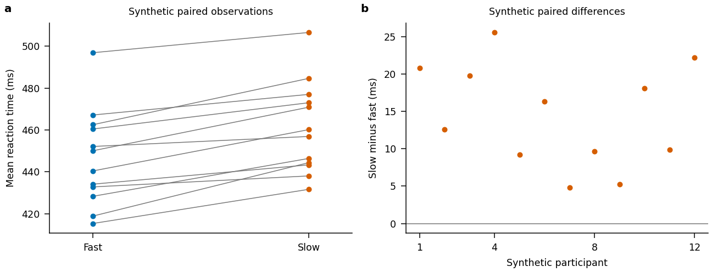

# Research skills

A skill packages a procedure you want to repeat: instructions, and sometimes a script or template. Keep the project's standing rules in `AGENTS.md`; give a skill a narrow job with a clear trigger and a result you can check. Start with the [installation locations](resources.md#skills), then read every file you install.

## Which supplied skill should you use?

The three existing downloads address different problems. Reviewing their instructions shows useful boundaries, but also checks you need to supply when using them:

| Skill | Keep it for | Check when you use it |
|---|---|---|
| [review-ai-code](resources.md#skills) | Reviewing the diff, weakened tests, silent failures and unrequested analysis choices | Include untracked files: plain `git diff` does not show their contents. Agree the baseline and report tests that were not run. This is code review, not a full statistical audit. |
| [known-answer-test](resources.md#skills) | Running the actual analysis on a planted effect and a null control | Set tolerances before the run. A noise-only result will not be exactly at chance, and a non-significant result does not prove there is no effect. Use suitable uncertainty bounds or repeated simulations, and add invalid-input checks. |
| [manuscript-guard](resources.md#skills) | Keeping sentences, captions and citations under the authors' control | Put the prohibition in `AGENTS.md` too, so it is present before a skill loads. Interpret the workflow's reference to manuscript-file changes as permitted technical changes only. The lab's confidentiality rules still apply; this skill is not permission to upload an unpublished draft. |

The examples below are portable adaptations of internal project-setup and figure workflows. They omit personal machine paths, remote hosts and dependencies on other internal skills. Their helper script can be run without an agent. A running helper and valid skill metadata do not prove that an agent follows the skill: try each skill on a small synthetic project and inspect its actions before relying on it.

## Project setup

Use this when starting a code or analysis repository. It proposes the folders, environment, configuration and checks before creating them, and refuses to overwrite existing work. It uses `AGENTS.md` for either agent and keeps participant data outside the workspace.

[:material-download: Download project-setup SKILL.md](../../assets/ai/skills/project-setup/SKILL.txt){ .md-button download="SKILL.md" }

??? example "Show the skill"
    ```markdown
    --8<-- "docs/assets/ai/skills/project-setup/SKILL.txt"
    ```

Try it with:

```text
Use project-setup for a Python prototype of a behavioural analysis.
Work with synthetic data only. Propose a minimal layout and environment,
with configuration in one file and tests for the actual analysis route.
Show the proposed files and commands before creating anything.
```

The [first-project walkthrough](first-project.md) shows what happens next. Adapt the folders to the task; a small script does not need the architecture of a software package.

## Manuscript figures

Use this for consistent multi-panel plots generated from code. Agree what each panel shows, keep font sizes, colours and export settings in `style.py`, and build the panels from the original numerical outputs. Change plotting code without changing the analysis to make a figure look better.

[:material-download: Download manuscript-figures SKILL.md](../../assets/ai/skills/manuscript-figures/SKILL.txt){ .md-button download="SKILL.md" }

??? example "Show the skill"
    ```markdown
    --8<-- "docs/assets/ai/skills/manuscript-figures/SKILL.txt"
    ```

### A runnable style and layout example

Download both files into the same folder. The script generates a synthetic paired-observation panel and a differences panel, with a shared style. It needs NumPy and Matplotlib in your project environment.

[:material-download: Download style.py](../../assets/ai/figures/style.py){ .md-button download="style.py" }
[:material-download: Download figure_example.py](../../assets/ai/figures/figure_example.py){ .md-button download="figure_example.py" }

```bash
python figure_example.py --output results/figures/example
```

The command creates a vector PDF, a PNG preview and a JSON record containing the seed, summary values, software versions and hashes of both source files. It refuses to overwrite an existing output; pass `--overwrite` deliberately to regenerate it. These synthetic numbers are an export demonstration, not an analysis result.



The example uses Nature's double-column width and text settings. Its default font is DejaVu Sans for portability; choose an installed Arial or Helvetica in `style.py` for submission, then inspect the regenerated PDF. Do not scale a finished figure down in a document without checking its final text sizes again.

### What comes from Nature, and what is our example?

For **Nature main figures**, the current guide specifies widths of 89 or 183 mm, a maximum height of 170 mm, and editable vector artwork. Its [layout and export guidance](https://research-figure-guide.nature.com/figures/building-and-exporting-figure-panels/) also gives an accessible example palette. The [text specifications](https://research-figure-guide.nature.com/figures/preparing-figures-our-specifications/) give 5–7-point ordinary text, bold upright lowercase 8-point panel labels, embedded fonts and `pdf.fonttype = 42` for Matplotlib. Check the target journal and figure type: Extended Data has different export requirements.

Our example chooses 7-point ordinary text, a 70-mm height, blue and vermillion data marks, black text, and a PNG preview alongside the PDF. Those are configurable choices. Nature does not require our particular two-panel arrangement. Colour alone should not carry meaning: the paired lines, panel labels and axis labels also identify what is shown.

Try the skill with:

```text
Use manuscript-figures to propose a two-panel figure from my synthetic
summary CSVs. Panel a shows each participant's two condition means;
panel b shows the paired differences. Use the existing style.py and
check the current Nature main-figure specifications. Do not change the
analysis or manuscript text. Show the layout before implementing it,
then render and inspect both exports at their final size.
```

## Other useful skills to build

These are suggestions, not additional downloads. Adapt them to your project's files and run commands before sharing them.

| Skill idea | Repeatable job | Evidence it should leave |
|---|---|---|
| Methods audit | Compare stated filters, exclusions, preprocessing and inference with code and configuration in both directions | A mismatch table with source locations and values; no manuscript edits |
| Results audit | Compare reported numbers with generated results, using tolerances appropriate to estimates, counts and p-values | A table of matches, stale values and unverifiable claims |
| Statistics and ML audit | Check cross-validation groups, leakage, circular selection, permutation schemes and multiple comparisons | Fold-overlap checks, justified null controls and unresolved assumptions |
| Reference check | Verify bibliographic metadata and whether a read source supports the claim | DOI/title matches, missing keys and unverified entries; never invented references |
| Reproducible run | Run a specified command with recorded configuration, environment, seed and input provenance | Exit status, logs and output paths that another person can reproduce |
| Session handoff | Record what works, what is unfinished and the next agreed step | Current commands and evidence, with a fresh-state check when resuming |

The internal audits and handoff workflows are useful starting points for these procedures. Their private paths, manuscript access assumptions and machine-specific commands need adapting before lab-wide use. Keep manuscript audits within the lab's approved confidentiality workflow, or work only on public examples.

## Check a skill before trusting it

Use a throwaway repository with synthetic fixtures. For a reviewer, plant a weakened assertion and a function that hides an error. For project setup, include a file it must preserve. For figures, check dimensions, legibility and editable PDF text, and confirm the plotted values match the input. Record the tool version, prompt, commands and failures. A skill that passes one example still needs review on your own task.

When a skill fails, fix the specific instruction that caused the failure. Keep journal requirements distinct from lab preferences, avoid broad triggers that activate on unrelated tasks, and include only helpers that a new user can actually run.
